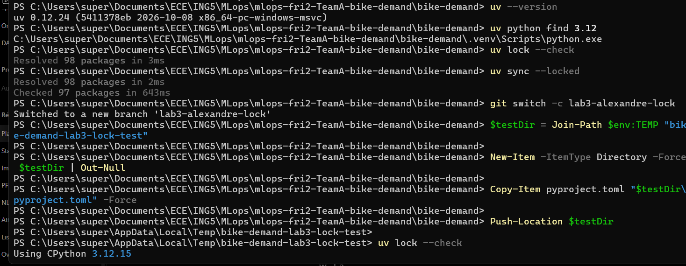
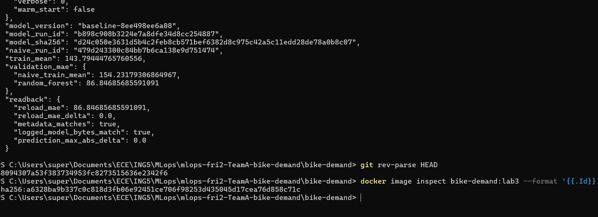
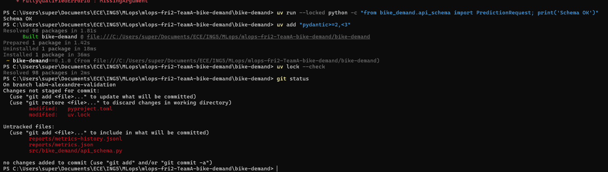
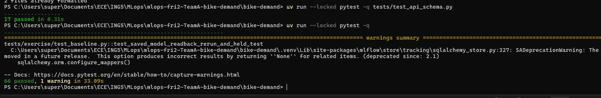
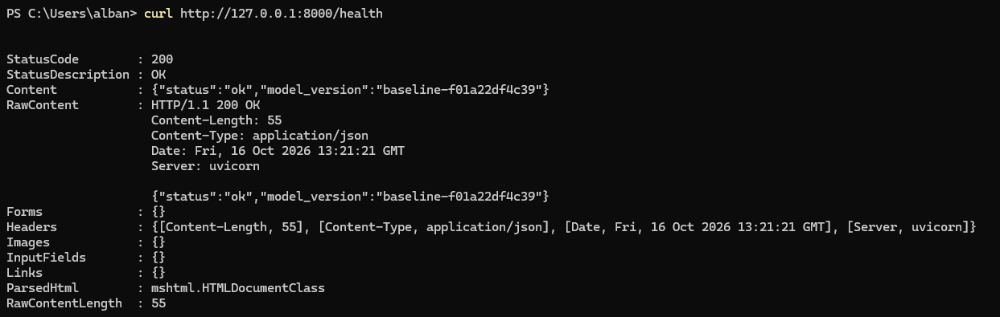
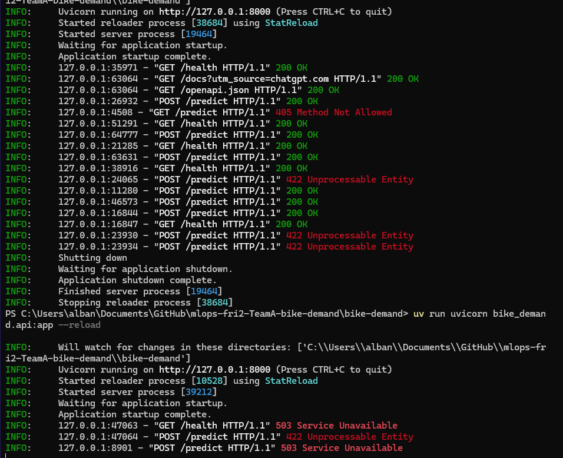
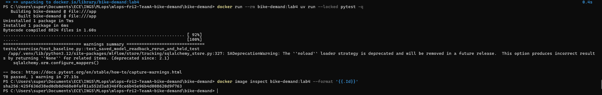
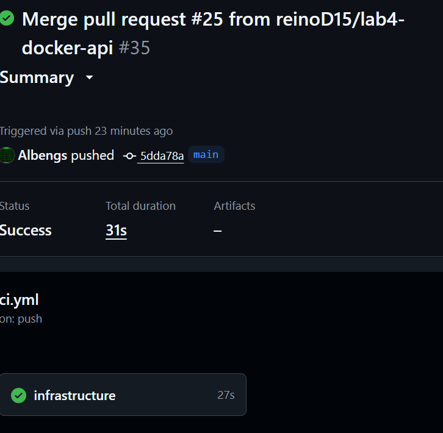

# Week 2, Labs 3–4

**Team:** Team A - Alexandre, Thaddée, Alban, Nicolas  
**Repository:** `mlops-fri2-TeamA-bike-demand`  
**Week:** 2 
**Status:** Lab 4 Docker image rebuilt and 78 automated tests passed on updated `main`; final HTTP checks on this image, CI evidence and `m2` tag remain to document.

## Team and roles

| Member | Observed contribution |
| --- | --- |
| Alexandre | Lab 3 lock/dependency checks; Lab 4 strict Pydantic request schema; integration and repair of API tests and dependencies; Docker test verification |
| Thaddée | FastAPI application, saved-model loading and integrity checks |
| Alban | API tests and manual HTTP endpoint checks; reviewed and merged Nicolas's Docker PR (reported by team) |
| Nicolas | Dockerfile and Lab 4 container-serving integration |

The assignments above reflect work discussed and evidence provided. Add actual PR URLs and review observations below rather than treating a merge alone as proof of a substantive review.

## Repository, integration and traceability

- Integration branch: `main`; Alexandre confirmed it was up to date with `origin/main` after the Docker PR merge.
- Lab 3 observed commit: `8094307a53f383734953fc8273515636e2342f6` (Alexandre's recorded Docker rerun).
- Lab 3 image ID observed on that rerun: `sha256:a6328ba9b337c0c818d3fb06e92451ce706f98253d435045d17cea76d858c71c`.
- Final Lab 4 `main` commit reported by Alexandre: `5dda78a2ade1d8b5abddde9c937505118503150a`.
- Lab 4 image rebuilt after Docker PR merge: `sha256:425f636d38ed0db8d468e0faf81a552d3a8346f8ce6b45e96b4d008620d9f763`.
- Final model SHA256 measured locally: `fd98ceafc57a5babce61ce703cbf9cb8d1f83c6820b0b34fe30ad1a0fc49c304`.
- Review comments, CI evidence and annotated `m2` tag: **to attach/verify**.

## Lab 3 - Same code, clean environment

### Dependency locking and clean setup

The project uses Python 3.12, `uv`, `pyproject.toml` and `uv.lock`. Alexandre recorded:

```powershell
uv --version
uv python find 3.12
uv lock --check
uv sync --locked
```

Observed on Windows: `uv 0.12.24`, Python 3.12.15; lock check resolved 98 packages, and `uv sync --locked` checked 97 packages. A deliberate negative check copied only `pyproject.toml` into a temporary folder and ran `uv lock --check`: it failed because `uv.lock` was absent. This demonstrates that a lockfile is required for that check; it does **not** independently prove cross-platform reproducibility.



*Figure 1 - Windows uv version, successful locked sync, and negative lockfile test; branch `lab3-alexandre-lock`.*

### Docker build and training rerun

The Lab 3 Dockerfile used a Python 3.12 slim base image, pinned uv tooling, locked installation and the baseline training command. The team built and ran `bike-demand:lab3`. A screenshot records a completed Docker build and container execution; the run printed model metadata and readback diagnostics.

```powershell
docker build -t bike-demand:lab3 .
docker run --rm bike-demand:lab3
docker image inspect bike-demand:lab3 --format '{{.Id}}'
git rev-parse HEAD
```



*Figure 2 - Docker build and training rerun on commit `8094307a53f383734953fc8273515636e2342f6`.*

### Model comparison and readback

The observed container run printed the following validation values (rentals/hour, MAE):

| Metric | Observed value |
| --- | ---: |
| Train-mean comparator validation MAE | 154.23179306864967 |
| Random forest validation MAE | 86.84685685591091 |
| Reloaded model validation MAE | 86.84685685591091 |
| Reload MAE delta | 0.0 |
| Prediction maximum absolute delta | 0.0 |
| Metadata matches | `true` |
| Logged model bytes match | `true` |

One captured run identified the model as `baseline-8ee498ee6a08` and SHA256 as `d24c050e3631d5b4c2feb8cb571bef6382d8c975c42a5c11edd28de78a0b8c07`. Model versions/run IDs can change between executions; this table is tied to the displayed run, not a universal invariant.



*Figure 3 - Observed MAEs, model identity and zero-delta readback checks.*

**Limitations:** A local/container comparison across different machines and full raw build/train logs have not been supplied for this pack. Do not claim byte-identical models across platforms. The original Lab 3 training image and current Lab 4 serving image correspond to different Dockerfile revisions.

## Lab 4 - Prediction API

### SERVE: saved model without retraining

The FastAPI application is implemented in `src/bike_demand/api.py`. It loads `artifacts/model.joblib` and `artifacts/model-metadata.json` at startup. It checks artifact existence, model SHA256 and the expected feature list before accepting the model.

| Endpoint | Expected outcome |
| --- | --- |
| `GET /health` | `200` with status and `model_version` when model is usable; `503` otherwise |
| `POST /predict` | `200` with nonnegative finite `prediction` and `model_version` for valid input |
| `POST /predict` | `422` for invalid/missing/extra fields |
| `POST /predict` | `503` when the model is unavailable |

No training is performed at API startup.

### VALIDATE: strict twelve-feature schema

`src/bike_demand/api_schema.py` uses Pydantic with eight strict integers and four strict finite floats; unexpected fields are forbidden.

| Field(s) | Validation |
| --- | --- |
| `season` | integer, 1–4 |
| `yr`, `holiday`, `workingday` | integer, 0–1 |
| `mnth` | integer, 1–12 |
| `hr` | integer, 0–23 |
| `weekday` | integer, 0–6 |
| `weathersit` | integer, 1–4 |
| `temp`, `atemp`, `hum`, `windspeed` | finite float, 0–1 |

Alexandre's screenshot shows **17 passing schema tests** and **66 passing tests overall** at an earlier intermediate revision. These are not the final counts.



*Figure 4 - Schema validation tests: 17 passed; intermediate full suite: 66 passed, one MLflow/SQLAlchemy deprecation warning.*

### VERIFY: automated and manual tests

Alban prepared `tests/test_api.py`; Alexandre corrected Ruff import ordering and added the missing development test-client dependency (`httpx2`) to `pyproject.toml` and `uv.lock`. The API tests cover healthy and unavailable model states, invalid input, unexpected fields, and mismatched model SHA256.

Alexandre subsequently ran:

```powershell
uv run --locked ruff check .
uv run --locked ruff format --check .
uv run --locked pytest -q
docker build -t bike-demand:lab4 .
docker run --rm bike-demand:lab4 uv run --locked pytest -q
```

**Observed results:** Ruff passed; formatting check passed (15 files); local pytest **78 passed, 1 warning**; Docker pytest **78 passed, 1 warning in 27.12 s**. The warning concerns deprecated MLflow/SQLAlchemy loader behavior and did not fail the suite. After PR #25 was merged, Alexandre rebuilt the image from updated `main` and reran the full Docker test suite: **78 passed, 1 warning in 27.15 s**. The updated image ID is recorded above.

Manual HTTP checks performed by Alban show `GET /health` returning `200` and a valid `POST /predict` returning `prediction = 83.56200000000001`, `model_version = baseline-f01a22df4c39`.



*Figure 5 - Manual `/health` HTTP 200 response, with model version `baseline-f01a22df4c39`.*

A Uvicorn log also shows `200` on valid calls, `422` on invalid prediction input, and `503` for health/predict when the model is unavailable. These logs show manual API behavior; they are **not, by themselves, evidence that the requests were made to the final Docker container**.



*Figure 6 - Uvicorn logs with successful, invalid-input and model-unavailable responses.*

### Docker serving and artifact identity

Nicolas adapted the Dockerfile to include the saved model and metadata and to start Uvicorn on port 8000. The team reported that Nicolas completed the build/test/HTTP/identity steps and Alban merged the PR. The final post-merge Docker test screenshot is attached below. The team reports that Nicolas also tested `/health` and `/predict` successfully with the Docker-served API. The raw HTTP responses, model version and exact image identifier from Nicolas’s session have not been provided; this success is therefore reported by the team, rather than independently evidenced by an attached HTTP log. Earlier HTTP screenshots were recorded from a separate local run.

For a reproducible check on merged `main`:

```powershell
git switch main
git pull --ff-only origin main
git rev-parse HEAD
docker build -t bike-demand:lab4 .
docker run --rm bike-demand:lab4 uv run --locked pytest -q
docker image inspect bike-demand:lab4 --format '{{.Id}}'
uv run --locked python -c "from pathlib import Path; from bike_demand.preflight import sha256; print(sha256(Path('artifacts/model.joblib')))"
docker run --rm --name bike-api -p 8000:8000 bike-demand:lab4
```

In another terminal:

```powershell
Invoke-RestMethod http://localhost:8000/health
```

Then send a valid `POST /predict` request with all twelve features, and record the JSON response. Stop the server with `docker stop bike-api`.

**Important:** the screenshot from Nicolas records model SHA256 `fd98ceafc57a5babce61ce703cbf9d8d1f83c6820b0b34fe30ad1a0fc49c304`; the earlier Lab 3 run records a different model SHA. This is not automatically an error: it reflects different saved model artifacts/runs. Check that the SHA used by the **final Lab 4 image** agrees with its bundled metadata.



*Figure 7 - Rebuilt Lab 4 image on updated `main`: 78 passed, 1 warning in 27.15 s; image `sha256:425f636d38ed0db8d468e0faf81a552d3a8346f8ce6b45e96b4d008620d9f763`.*

## Pull requests, review and integration

| PR | Change | Author (as displayed) | Status |
| --- | --- | --- | --- |
| [#13](https://github.com/reinoD15/mlops-fri2-TeamA-bike-demand/pull/13) | Lab 3 dependency lock and missing-lock check | AlexDreams | Merged |
| [#14](https://github.com/reinoD15/mlops-fri2-TeamA-bike-demand/pull/14) | Lab 3 Dockerfile | TaDLpZ | Merged |
| [#15](https://github.com/reinoD15/mlops-fri2-TeamA-bike-demand/pull/15) | Lab 3 Docker build/image test | Albengs | Merged |
| [#16](https://github.com/reinoD15/mlops-fri2-TeamA-bike-demand/pull/16) | Lab 3 README documentation | reinoD15 | Merged |
| [#19](https://github.com/reinoD15/mlops-fri2-TeamA-bike-demand/pull/19) | Lab 4 strict request validation | AlexDreams | Merged |
| [#21](https://github.com/reinoD15/mlops-fri2-TeamA-bike-demand/pull/21) | FastAPI application | TaDLpZ | Merged |
| [#22](https://github.com/reinoD15/mlops-fri2-TeamA-bike-demand/pull/22) | Evaluated model artifacts | AlexDreams | Merged |
| [#24](https://github.com/reinoD15/mlops-fri2-TeamA-bike-demand/pull/24) | API tests and `httpx2` dependency | AlexDreams | Merged |
| [#25](https://github.com/reinoD15/mlops-fri2-TeamA-bike-demand/pull/25) | Docker API serving | reinoD15 | Merged by Alban (team report) |

PRs [#20](https://github.com/reinoD15/mlops-fri2-TeamA-bike-demand/pull/20) and [#23](https://github.com/reinoD15/mlops-fri2-TeamA-bike-demand/pull/23) were closed without merge. Reviewer comments should be linked if required; merge status alone does not prove a particular review comment. The `main` push CI for the merge of PR #25 is documented below.


## Continuous integration on merged `main`

GitHub Actions run **[#35](https://github.com/reinoD15/mlops-fri2-TeamA-bike-demand/actions/runs/35)** is **not a verified URL** (run number 35 shown in the screenshot is the workflow display number, not necessarily the GitHub Actions run ID). Locate the run through [GitHub Actions](https://github.com/reinoD15/mlops-fri2-TeamA-bike-demand/actions) and its title **“Merge pull request #25 from reinoD15/lab4-docker-api #35”**.

The screenshot shows a **successful** workflow on branch `main`, pushed by `Albengs` at commit prefix `5dda78a`, matching the recorded full HEAD `5dda78a2ade1d8b5abddde9c937505118503150a`. The `infrastructure` job passed in **27 s** and the workflow took **31 s**. This CI screenshot confirms the **infrastructure job only**; the full 78-test suite is evidenced separately by the Docker run, not by this CI job.



*Figure 8 - CI success on `main` after PR #25 merge; commit `5dda78a`, `infrastructure` job 27 s, total 31 s.*

## Contribution, assistance and limitations

The team collaborated across API implementation, schema validation, testing, Docker integration and review. 


