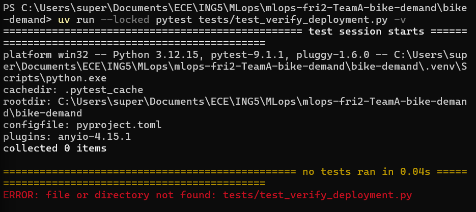
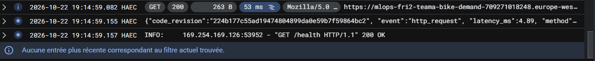
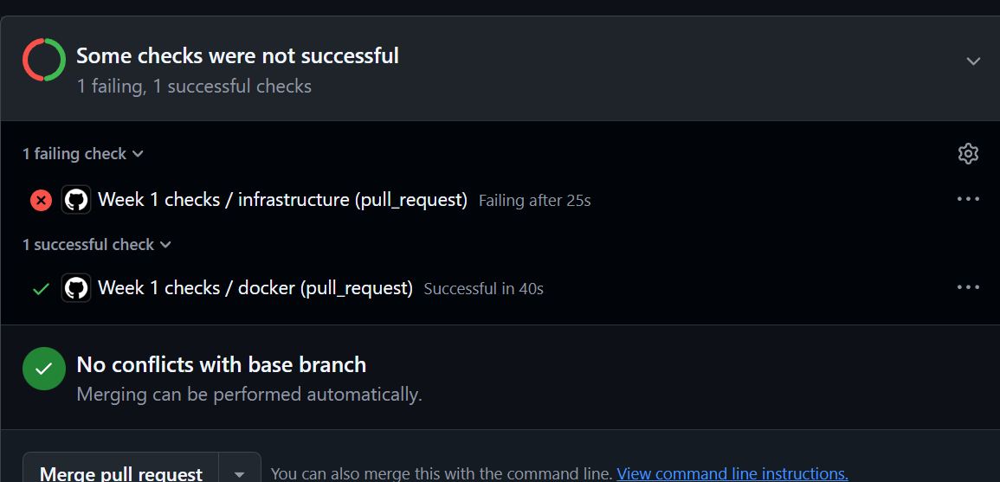
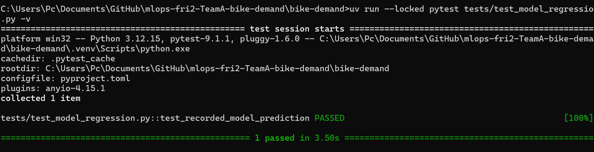

# Week 3, Labs 5–6: deployment, structured logs, model-version checks, GitHub Actions

**Team report — Team A / Bike Demand**  
**Status:** Labs 5–6 evidence assembled on 23 October 2026. Lab 5 deployment and Lab 6 CI tests demonstrated; **CI-gated CD, automated rollback and cross-environment tolerance justification remain incomplete**.

## Student / team

Team A, ECE MLOps. **Lab 5:** Alexandre, Thaddée and Alban contributed to the team work. **Lab 6:** the documented CI work was carried out by Alexandre and Thaddée; Alban was absent for Lab 6. Contributions below distinguish confirmed assignments and observed evidence.

## Links to code and pull requests

- Repository: https://github.com/AlexDreams/mlops-fri2-TeamA-bike-demand
- CI workflow: `.github/workflows/ci.yml`; deployment build: `cloudbuild.yaml`; Docker image: `bike-demand/Dockerfile`.
- API: `bike-demand/src/bike_demand/api.py`; deployment verifier: `bike-demand/scripts/verify_deployment.py`.
- Tests: `bike-demand/tests/test_api.py`, `test_api_schema.py`, `test_model_regression.py`, `test_verify_deployment.py`.
- CI implementation: [PR #35](https://github.com/AlexDreams/mlops-fri2-TeamA-bike-demand/pull/35).
- Red-to-green defect and repair: [PR #36](https://github.com/AlexDreams/mlops-fri2-TeamA-bike-demand/pull/36).
- Failing CI job: [run 39940905449](https://github.com/AlexDreams/mlops-fri2-TeamA-bike-demand/actions/runs/39940905449/job/120371800256?pr=36).
- Passing CI job: [run 39942844497](https://github.com/AlexDreams/mlops-fri2-TeamA-bike-demand/actions/runs/39942844497/job/120378238321).
- README includes Lab 5 deployment instructions and Lab 6 CI decisions (14 questions); the README documentation PR ([PR #37](https://github.com/AlexDreams/mlops-fri2-TeamA-bike-demand/pull/37)) was reviewed and merged by Thaddée.

## Test and execution results (commands, revision, observed output)

### Lab 5 — Docker, Cloud Run, health and logs

Cloud project: `mlops-demo-512323`; Cloud Run service: `mlops-fri2-teama-bike-demand`; region: `europe-west1`. The service requires authentication. `cloudbuild.yaml` builds a Docker image with `BIKE_DEMAND_REVISION=$COMMIT_SHA`, pushes it to Artifact Registry, and deploys it to Cloud Run. This is the **existing independent Cloud Build trigger**, not a GitHub-Actions-gated deployment.

An observed successful Cloud Build had ID `41f8aa89-5ce9-4f5f-82ac-6fe57f6b7f9`, sourced from `main` at commit `224b177c55ad19474804899da0e59b7f59864bc2`. All three steps — build, push, deploy — succeeded (see screenshot).

Authenticated `/health` returned HTTP 200 with `status: ok`, `model_version: baseline-f01a22df4c39`, and `code_revision: 224b177c55ad19474804899da0e59b7f59864bc2`. The same identity was confirmed through the local authenticated Cloud Run proxy (`gcloud.cmd run services proxy ... --port 8080`) and the verifier:

```powershell
python .\bike-demand\scripts\verify_deployment.py --url http://127.0.0.1:8080 --expected-model baseline-f01a22df4c39 --expected-revision 224b177c55ad19474804899da0e59b7f59864bc2
```

Observed: `Deployment verification PASSED`. Supplying an intentionally incorrect model version produced `Deployment verification FAILED`, demonstrating a negative verification case. The three verifier unit tests (`matching_deployment_passes`, `wrong_model_fails`, `wrong_revision_fails`) passed locally.

The application emits structured request logs including `event`, `method`, `path`, `status_code`, `latency_ms`, `request_id`, `model_version` and `code_revision`. An observed `/health` request had HTTP 200 and latency `4.89 ms`. No secrets or raw prediction payloads should be logged. A screenshot of this structured log was provided, but the four embedded screenshots below prioritize deployment, verification, and CI failure evidence.

### Lab 6 — CI and red-to-green proof

GitHub Actions runs on pull requests to `main`, pushes to `main`, and manual dispatch. The `infrastructure` job runs on `ubuntu-24.04` with Python 3.12, `uv sync --locked`, preflight, Ruff checks and `uv run --locked pytest -q --strict-markers`. The `docker` job builds `./bike-demand`. `pyproject.toml` registers the `infra`, `lab1` and `exercise` pytest markers and enables strict marker/config checks.

**Deliberate defect:** change `hr: StrictInt = Field(ge=0, le=23)` to `hr: StrictInt = Field(ge=0)`, allowing invalid hours. In PR #36, the infrastructure job failed:

```text
FAILED tests/test_api.py::test_predict_invalid_request[hr-25] - assert 200 == 422
FAILED tests/test_api_schema.py::test_invalid_values[hr-30] - Failed: DID NOT RAISE ValidationError
2 failed, 80 passed, 1 warning in 8.71s
Error: Process completed with exit code 1.
```

The warning concerned MLflow/SQLAlchemy and did not cause the failure. The full raw failing job log is retained unchanged at [`evidence/ci-red-pr36-infrastructure.txt`](evidence/ci-red-pr36-infrastructure.txt). Defective history includes commits `86f1a4e` and `9efd1a1`. **Repair:** restore `le=23` in commit `2f4d24f`, without weakening or skipping tests. The subsequent infrastructure and Docker checks passed, and PR #36 was merged. The PR's final diff may be empty because the deliberate defect was repaired in the same PR; commit history and red/green run logs carry the evidence.

The recorded model regression test loads `artifacts/model.joblib` and metadata, reconstructs the feature order, and compares against `83.56200000000001` for model version `baseline-f01a22df4c39` using `pytest.approx(abs=1e-6, rel=0)`. A local targeted test passed. Twenty repeated local predictions produced identical values: min = max = reference = `83.56200000000001`, maximum absolute difference `0.0`, repeat variation `0.0`. **Limitation:** this shows local stability, not an empirical basis for the cross-machine tolerance `1e-6`; further Windows/Linux or dependency-environment comparisons are needed.

A prior full local test suite run reported **82 passed, 1 warning** using `uv run --locked pytest -q --strict-markers` (the MLflow/SQLAlchemy warning was nonfatal). This local run is not substituted for the linked GitHub CI evidence.

## Screenshots

The template requests 2–4 screenshots. These four are selected from the supplied captures; all paths are relative to this report.



*Figure 1 — Lab 5: successful Cloud Build run `41f8aa89-5ce9-4f5f-82ac-6fe57f6b7f9`, deploying `main` commit `224b177c...`.*



*Figure 2 — Lab 5: verifier reports `PASSED` for the expected model and revision, and `FAILED` for an intentionally incorrect model version; deployed code revision `224b177c...`.*



*Figure 3 — Lab 6: PR #36 failing `infrastructure` check and successful `docker` check, before the repair; failing run `39940905449`.*



*Figure 4 — Lab 6: local recorded-prediction regression test passing (`1 passed`), using the model version recorded in the test. This is local evidence, not the CI run.*

## My contribution

**Lab 5 — assigned responsibilities and delivered work**

- **Alexandre:** created `bike-demand/scripts/verify_deployment.py` to query the running container over HTTP, check readiness, compare `model_version` and the deployed Git `code_revision` against expected values, and exit with failure on a mismatch. The provided terminal evidence shows both `Deployment verification PASSED` and a deliberate `FAILED` for a wrong model version. Also collected the authenticated Cloud Run checks and deployment evidence.
- **Thaddée:** handled structured request logging in `bike-demand/src/bike_demand/api.py` (HTTP status, latency, request ID, model version) and made `GET /health` expose `code_revision` derived from `BIKE_DEMAND_REVISION`. The supplied Cloud Run log screenshot shows the structured fields and revision.
- **Alban:** handled the Dockerfile and runtime configuration for Lab 5, runtime settings, and the `Deploy` section of the root README. His task was to make `BIKE_DEMAND_REVISION` available to the container and document the Docker build/run command. These responsibilities are reflected in the repository's Docker and deployment documentation. His Lab 5 contribution was merged in PR #30.

Each member worked on their personal branch (`alexandre-dev`, `thaddee-dev`, `alban-dev`) with PRs targeting `main` as the agreed workflow. **The planned Lab 5 review assignments** were Alban reviewing Alexandre's PR, Thaddée reviewing Alban's PR, and Alexandre reviewing Thaddée's PR; actual completed approvals are not asserted without GitHub review records.

**Lab 6 — documented contributions**

- **Alexandre:** reviewed PR #36 without knowing the defect in advance, diagnosed the hour-validation failure from the CI log and reported it to Thaddée; checked the local test suite and repeated numerical prediction; documented the 14 Lab 6 CI questions in the root README; collected the failing CI log and deployment evidence; investigated the Google Cloud identity/permissions blocker.
- **Thaddée:** implemented or integrated CI and regression testing, introduced and repaired the controlled schema defect within PR #36, and reviewed/merged Alexandre's README documentation PR.
- **Alban:** no Lab 6 technical contribution is claimed in the available evidence.


### Confirmed merged pull requests

**Lab 5**
- Alexandre: PR #28 — external deployment verification.
- Thaddée: PR #29 — API logging and revision reporting.
- Alban: PR #30 — Docker deployment and runtime documentation.
- Alexandre: PRs #31, #32 and #33 — Cloud Build deployment, logging configuration and documentation.

**Lab 6**
- Thaddée: PR #34 — model regression test.
- Thaddée: PR #35 — GitHub Actions CI workflow.
- Thaddée: PR #36 — controlled failure and repair.
- Alexandre: PR #37 — CI decisions and red-to-green documentation.

All these PRs are recorded as merged on GitHub. Formal review approvals must be checked separately.

Repository: https://github.com/AlexDreams/mlops-fri2-TeamA-bike-demand

## Decisions and rationale

**Lab 5:** Alexandre’s HTTP verification script, Thaddée’s structured logging and revision-aware `/health`, and Alban’s Docker/runtime/README work form the three complementary implementation responsibilities. Reuse the saved model rather than retraining at API startup; validate model metadata and hashes before readiness; keep Cloud Run private; inject the Git SHA into the Docker build; verify both `model_version` and `code_revision`; use structured logs without secrets. We rejected anonymous access, silent model replacement, and a successful build as sufficient proof of a healthy live deployment.

**Lab 6:** Use clean GitHub-hosted runners and locked dependencies; run preflight, Ruff, full pytest and Docker checks on PRs and `main`; require tests that genuinely fail on a known defect; repair the implementation rather than muting tests; retain raw logs and exact run links. We rejected laptop-only validation, disabling assertions, regenerating the lockfile to force green, and presenting local MLflow runs as CI evidence. The detailed 14 choice/rejected-option/rationale answers are in the root README.

**Deployment gate design (not yet operational):** A future deploy job should require successful `infrastructure` and `docker` jobs, run only for the intended `main` revision, authenticate via GitHub OIDC and Google Workload Identity Federation without a stored service-account key, invoke Cloud Build, verify the private `/health` response, and restore the previous healthy Cloud Run revision if verification fails. The independent team Cloud Build push trigger must be retired **only after** a working replacement has been validated; other teams' triggers must not be touched.

## Review and response

PR #36 preserved the defective commits, failed checks, repair commit, and subsequent green checks on the same PR. Thaddée merged Alexandre's README documentation PR. A formal approving review for PR #36 has not been independently established by the provided evidence; no such approval is claimed. Review comments and exact README PR number should be added if available. The exact Lab 5 PRs/commits and completed review approvals for Alexandre, Thaddée, and Alban should be linked if available; the review rotation described above is the agreed plan, not proof of completed approvals.


### Verified Lab 5 peer reviews

The planned Lab 5 review rotation was completed with the following GitHub evidence:

- PR #28 (Alexandre): Alban (`Albengs`) left a positive review comment and merged the PR.
  https://github.com/AlexDreams/mlops-fri2-TeamA-bike-demand/pull/28#issuecomment-6337339458
- PR #29 (Thaddée): Alexandre (`AlexDreams`) submitted a formal APPROVED review and merged the PR.
  https://github.com/AlexDreams/mlops-fri2-TeamA-bike-demand/pull/29
- PR #30 (Alban): Thaddée (`TaDLpZ`) confirmed the Dockerfile changes in a comment and merged the PR.
  https://github.com/AlexDreams/mlops-fri2-TeamA-bike-demand/pull/30#issuecomment-6337631919

PRs #28 and #30 have review comments but no formal GitHub APPROVED review records. PR #36 (Lab 6) was merged by Alexandre; no formal review or discussion comment is recorded in the checked GitHub fields.

### Lab 6 "break it on purpose" (PR #36)

- **Defect:** Thaddée chose and introduced it: he removed `le=23` from `hr`.
- **Review:** Alexandre reviewed the PR without being told what the defect was. He identified it from the red `infrastructure` check and its log (`assert 200 == 422` for `hr=25`; `DID NOT RAISE` for `hr=30`) and reported it.
- **Repair:** Thaddée then repaired it in commit `2f4d24f` on the same PR; the checks turned green and Alexandre merged.
- **Outcome:** the existing tests caught the defect, so no missing test had to be added.
- **Limitation:** the slide asks the reviewer to pick the bug without the test author knowing. Here the roles were reversed: the defect was chosen by the author of the tests (Thaddée, PR #34) and diagnosed by the reviewer. This shows that the CI catches this defect and that a reviewer can find the cause from the log. It is a weaker check of what the tests miss than a defect chosen by someone who did not write the tests.

## Blockers / missing evidence

1. **Keyless deployment authentication:** `gcloud.cmd iam workload-identity-pools list --location=global --project=mlops-demo-512323` returned `Listed 0 items.` Attempted pool creation returned `PERMISSION_DENIED: iam.workloadIdentityPools.create`. The project administrator must configure an OIDC provider, an appropriately scoped deploy identity, and the required service-account bindings. No JSON service-account key should be created as a workaround.
2. **CI-to-CD gate:** the Cloud Build trigger still runs independently of GitHub Actions. As a partial mitigation (25 October 2026), `cloudbuild.yaml` now starts with a "Run blocking checks" step (locked `uv sync`, preflight, Ruff, full pytest) before the Docker build, so a failing check stops the build before any image is pushed or deployed. Before merging, this step was reproduced locally in a clean `python:3.12-slim` container with only Git-tracked files and no `.git`: the first attempt failed (`FileNotFoundError`, because `tracking.py` calls the `git` binary, which the slim image lacks); after installing `git` in the step, preflight, Ruff and **84 passed** (exit 0). This is a local simulation; the first real Cloud Build run of this step happens on the next `main` deploy. The gate uses Cloud Build's checks, not the GitHub Actions result; no GitHub-Actions-gated deployment is claimed.
3. **Post-deploy rollback:** authenticated health verification exists, but automated CI-triggered rollback to a previous Cloud Run revision has not been implemented or demonstrated. Preparation: `verify_deployment.py` now sends an identity token from `BIKE_DEMAND_ID_TOKEN` as a Bearer header (never printed), covered by two new tests; the new token test was shown to fail when the header is removed. The Cloud Build service account holds `roles/run.admin`, so a no-traffic deploy → verify → traffic switch is feasible without extra IAM, but it is not built yet.
4. **Numerical tolerance:** local 20-run variation was zero, but cross-environment measurements supporting `abs=1e-6` remain missing.
5. **Additional audit items:** exact README PR link, Alban’s Lab 5 commit/PR attribution, any formal review approvals, final milestone tag `m3`, and individual Week 3 reports should be checked separately. This document is the **team report**, not a substitute for individual submissions.

## Assistance and recovery acknowledgement

The team used ChatGPT assistance to structure CI/deployment documentation, analyze Git and GitHub Actions evidence, interpret Cloud Run verification, and assemble this report. Technical outcomes are based on the supplied command output, screenshots, CI logs and repository history; blocked or untested steps are explicitly identified rather than claimed as completed. Recovery from the controlled CI failure was the repair of the `hr` validation upper bound, followed by successful checks. No production rollback was demonstrated.


